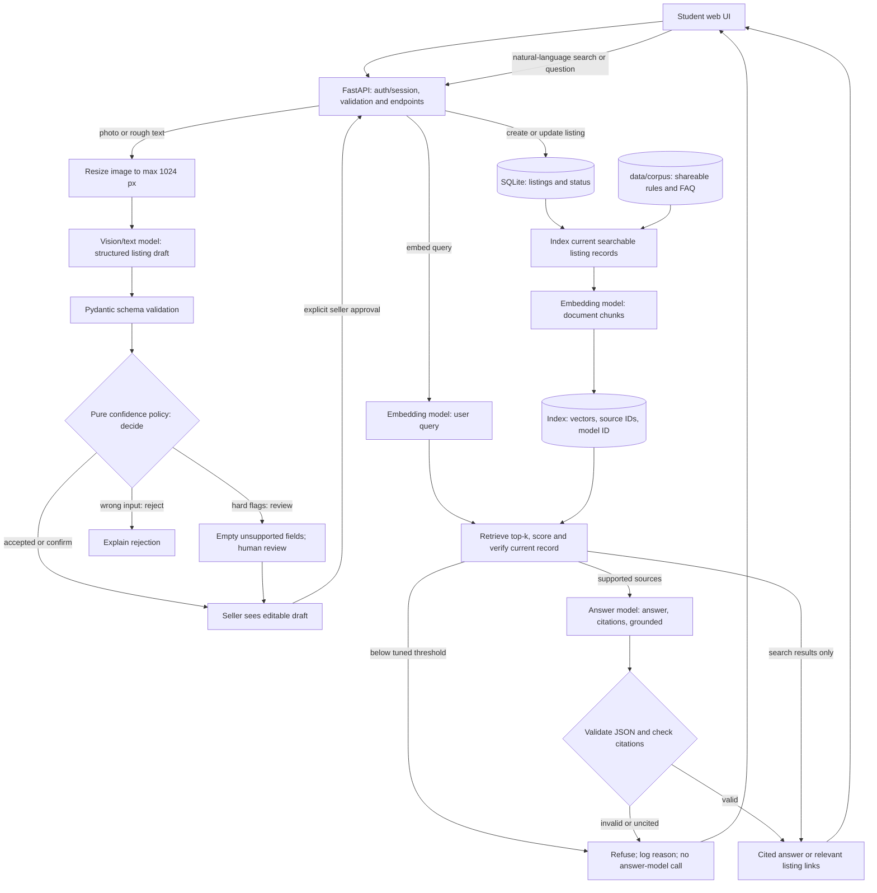

# Design Review · Unimarket · AI-Sloppers

**Members (GitHub usernames only):** [`@LashaJaparidze`](https://github.com/LashaJaparidze) · [`@Ti_Choto`](https://github.com/Ti_Choto) · [`@LukaVasadze07`](https://github.com/LukaVasadze07) · [`@terjolskiterjolski`](https://github.com/terjolskiterjolski). **Team approach:** shared development, testing, integration, and documentation; any coordination areas below are non-exclusive and can change as the project progresses.  
**Repo:** [TiChoto/AI-Sloppers](https://github.com/TiChoto/AI-Sloppers) · **Graded commit:** tag `design-review` on `main` (not yet created).  
**Evidence status (20 October 2026):** This is a design draft for a project starting from zero. Code, linked evidence, model runs, tests, and team decisions described as *planned* below have **not** been completed or verified. Do not change their status without repository evidence.

## 1 · Problem, users, success criteria (2 points)

**Problem.** University students buy and sell used textbooks, calculators, electronics, and dorm essentials through scattered chats and social-media posts. Listings are hard to compare, details are inconsistent, and a buyer may waste time asking for a price, condition, or availability already known to the seller. Unimarket puts structured listings in one searchable place and uses AI to assist—not replace—the seller.

**Users.** Students selling used items and students looking for affordable items at their university. The first release is *student-focused*, not institution-verified: university SSO and identity verification are out of scope. The product spec will live at `docs/spec.md` (**planned; file not yet supplied**).

| # | Script-checkable success criterion | Evidence path / measurement | Today |
|---|---|---|---|
| S1 | A valid listing is saved with title, category, price, condition, and seller-approved description; invalid or negative prices are rejected. | `tests/test_listings.py`; listing API responses | Not implemented |
| S2 | Image-assisted drafting never publishes automatically; missing or unsupported fields are left empty and routed to confirmation or review. | `tests/test_confidence.py`; `docs/confidence-policy.md` | Not implemented |
| S3 | Grounded marketplace Q&A cites only retrieved listing/rule sources; insufficient evidence triggers a refusal, including before model invocation when retrieval is weak. | `tests/test_answer.py`; `evals/golden.yaml`; answer/refusal logs | Not implemented |
| S4 | The five-question live golden set meets the **0.70** threshold; actual results and failures are committed. | `evals/results/<timestamp>.json` | Not run |

## 2 · Architecture and data flow (2 points)

**Proposed architecture (not an as-built diagram):** responsive web UI; Python/FastAPI API; SQLite for initial listings; approved marketplace rules and shareable listing descriptions for retrieval. Payments, delivery, and automatic university identity verification are excluded from the MVP.

The seller's photo/text goes to a **Lab 3 multimodal model** only after downscaling. The model proposes field-wise `{value, evidence, confidence}`; Pydantic validates the shape, and a deterministic `decide()` routes to `accepted`, `confirm`, `review`, or `rejected`. A low-confidence value alone cannot certify a field. Fields without evidence stay empty, and *even an accepted draft requires a seller click before publication*. See planned `docs/multimodal-spec.md` and `docs/confidence-policy.md`.

The **Lab 4 retrieval path** embeds approved documents and current listing records, stores source IDs and embedding-model identity, and retrieves scored results for a question. Listings are rechecked against the database before they are shown so sold/removed products are not presented as available. If nothing passes a tuned threshold, the service refuses **before** calling the answer model. Otherwise, the answer model returns `{answer, citations, grounded}`; code checks that citations belong to retrieved sources and cover factual sentences. Any failed check becomes a refusal, never an unsupported answer. See planned `docs/retrieval-spec.md`.

| Model call | Model ID | Input → output | Validation / evidence |
|---|---|---|---|
| Multimodal draft | **TBD; select and record actual model** | Resized product image + seller text → field values, evidence, confidence | JSON schema, Pydantic, `decide()`, seller confirmation; Lab 3 tests |
| Embed corpus/listings | **TBD; fixed at index creation** | Shareable text chunks → vectors + model metadata | Index rejects model-ID mismatch |
| Embed question | **Same embedding model** | User's search or question → vector | Dimensionality/model match; retrieval score |
| Grounded answer | **TBD; select and record actual model** | Retrieved numbered sources + question → `{answer, citations, grounded}` | Pydantic and deterministic citation checks; Lab 4 tests |

## 3 · Risks and safety threats (2 points)

All mitigations below are **planned**, not implemented. The GitHub handles in the final column are **proposed coordination contacts for these specific risks**, not exclusive implementation assignments; the team can redistribute work.

| Product-specific risk | User-visible harm | Mitigation and due week | Proposed contact (flexible) |
|---|---|---|---|
| Vision model invents brand, condition, or price from an unclear photo | Misleading listing and purchase decision | **Week 5:** require nullable per-field evidence, never infer price from an image, use `decide()` with hard/soft flags, and require seller approval (`docs/confidence-policy.md`, planned) | `@LashaJaparidze` |
| RAG invents a price, rule, or product availability | Buyer relies on incorrect information | **Week 5:** threshold-based pre-model refusal, citation validation, sold-status recheck, answer/refusal logs and offline tests (`tests/test_answer.py`, planned) | `@Ti_Choto` |
| Seller text or retrieved documents contain prompt injection | Assistant follows hidden instructions rather than marketplace rules | **Week 6:** treat all listing/document contents as untrusted data; test malicious instructions and refuse unsupported output | `@LukaVasadze07` |
| Photos or listings expose phone numbers, addresses, student IDs, or faces | Personal information leaked into corpus, logs, or AI requests | **Week 5:** synthetic/consented test images with no faces/IDs; avoid personal data in retrieval corpus; redact logs and keep API keys in environment variables | `@terjolskiterjolski` |
| Sold/deleted items remain in the search index | Buyers contact sellers about unavailable goods | **Week 6:** invalidate/reindex on status changes and verify live database status before responding | `@Ti_Choto` |
| Model outages or uncontrolled prompt size | Broken assistant or unexpected API spending | **Week 6:** user-visible fallback, request/token limits, usage logging and monitored costs | `@LashaJaparidze` |

## 4 · Evaluation plan (2 points)

- **Golden set:** `evals/golden.yaml` (**planned, not committed**); five questions from the **actual approved corpus**, classified as **2 factual, 1 reasoning across two sources, 1 edge case, 1 refusal**. Each will specify `expect`, `must_cite`, `must_mention`, and `why`. Candidate areas: a listing's stated price/condition, a marketplace rule, comparing two listings, a typo in a query, and a request for an unsupported guarantee. Expected answers will be written only after the sample records and rules exist.
- **Last live run:** **none** · **Committed result:** **none** · **Pass rate:** **N/A (0 questions executed; not 0/5)**. **Failures:** not yet observable; no test or model run has occurred. Planned runner: `evals/run_golden.py`; results in `evals/results/`.
- **Lab 4 verification:** add at least three offline tests: invented citation → refusal; low retrieval score → refusal without model call; valid `[n]` → corresponding retrieved source. Run a five-question live evaluation, change one retrieval setting (top-*k* or threshold), rerun, and record both results and the decision.
- **By Week 11:** expand to **10 cases: 3 factual, 2 reasoning, 2 edge, 2 refusal, 1 format**; use an independent judge for semantic answer checks. A score **below 0.70** will block pull-request merges in CI, not be hidden by changing expected answers. Keep failed runs and diagnose them.

## 5 · Token budget (1 point)

**Actual usage evidence:** `logs/usage.jsonl` (**not created**). There have been **no verified API calls**, so model prices, token medians, median latency, and cost per request cannot truthfully be reported yet. Each planned model call will record model ID, input/output tokens, billed cost, latency, timestamp, and feature. Report medians after **at least 10 real calls per measured feature**, with actual provider pricing.

| Feature | Model | Median input/output tokens | Median cost/request | Median latency | Source |
|---|---|---|---|---|---|
| Listing image draft | TBD | Not measured | Not measured | Not measured | `logs/usage.jsonl` (planned) |
| Grounded `/ask` + query embedding | TBD | Not measured | Not measured | Not measured | `logs/usage.jsonl` (planned) |
| Smart-search query embedding | TBD | Not measured | Not measured | Not measured | `logs/usage.jsonl` (planned) |

**Monthly load assumption (not actual usage):** 200 students × 2 AI questions per day × 30 days = **12,000 questions/month**, plus an estimated 20 assisted listings per day × 30 = **600 drafts/month**. Estimated monthly cost *once measured* = `12,000 × median /ask cost + 600 × median draft cost + indexing costs`; a monetary total is **pending real logs**.

**RAG vs. long context:** retrieval is selected because documents and listing records change and only a few need to be sent per answer. *Illustrative arithmetic, not a measured workload:* sending 20,000 corpus tokens in every prompt versus retrieving five 300-token chunks sends **20,000 vs. 1,500 source tokens/request** (about **13.3× less source context**, excluding shared instructions, output and embeddings). Replace these assumptions with actual corpus/chunk sizes and model prices in the measured budget.

## 6 · Team, roles and decisions (1 point)

- **Team contract:** `TEAM-CONTRACT.md` (**not yet verified on `main`**). **Role record:** `docs/TEAM-REPO.md`, section 1 (**planned / not verified**). The four contributors are `@LashaJaparidze`, `@Ti_Choto`, `@LukaVasadze07`, and `@terjolskiterjolski`.
- **Flexible responsibilities (proposed):** all members contribute across product development, AI/RAG integration, evaluation, testing, code review, and documentation as needed. For coordination only, `@LashaJaparidze` may help track implementation quality, `@Ti_Choto` integration, `@LukaVasadze07` testing, and `@terjolskiterjolski` documentation. These are **not exclusive roles** or fixed module assignments; the team will distribute tasks by availability and project needs. The proposed risk contacts in Section 3 may likewise be changed.
- **Decision 0001 (planned):** `docs/decisions/0001-human-approved-ai-drafts.md` — AI can suggest listing data but never publish without explicit seller approval; this limits invented details and preserves accountability.
- **Decision 0002 (planned):** `docs/decisions/0002-grounded-retrieval.md` — prefer scored, source-attributed retrieval over copying all listings into the answer prompt; choose a starting *k*/threshold, then record a real Lab 4 tuning run and rationale.
- **Next build steps (shared ownership):** implement and test a listing-create/read slice; add image extraction with confidence routing; build the cited-answer/refusal path and golden-set evaluation; connect the seller review interface. Specific task owners will be chosen as work starts and recorded in `docs/TEAM-REPO.md`. Delegated agent work will be recorded in `docs/delegation-log.md`. **These are plans, not completed work.**
