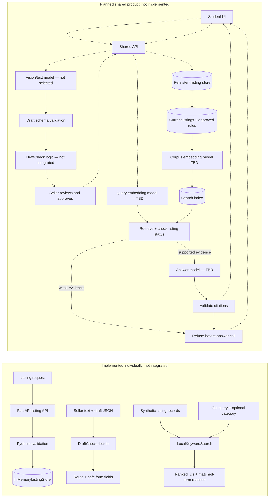

# Design Review — UniMarket — AI-Sloppers

**Team:** `@LashaJaparidze` · `@Ti_Choto` · `@LukaVasadze07` · `@Terjolskiterjolski` (Nikolozi Kutaladze)  
**Repository:** [TiChoto/AI-Sloppers](https://github.com/TiChoto/AI-Sloppers)  
**Snapshot reviewed:** 20 October 2026. The supplied ZIP has no Git history, so merge and `design-review` tag status must be checked in the live repository.

The snapshot contains four individual HW1 prototypes in separate folders, but no shared application source at the repository root. This review distinguishes those tested slices from the not-yet-integrated marketplace.

## 1. Problem, users, and success criteria

University students buy and sell used textbooks, calculators, electronics, and dorm items through scattered chats. Buyers struggle to compare listings; sellers repeatedly answer questions about price and condition. UniMarket aims to make these items searchable, with AI assistance while people retain control. The initial users are students; university identity verification, payments, and delivery are outside the current scope. A product-level `docs/spec.md` is not in this snapshot; the available specs describe individual HW1 slices.

| # | Success criterion | Evidence | Status in this snapshot |
|---|---|---|---|
| S1 | Create, retrieve, update, delete, and filter listings; reject invalid fields and inverted price ranges. | [Luka’s spec](../hw1/LukaVasadze07/spec.md), [API tests](../hw1/LukaVasadze07/src/tests/test_listings_api.py), [golden results](../hw1/LukaVasadze07/golden.md) | Standalone FastAPI prototype passes its recorded checks. It uses a process-local store, not durable team storage, and has no shared UI. |
| S2 | Unsupported draft fields are not silently prefilled; seller retains control of publication. | [Lasha’s spec](../hw1/LashaJaparidze/spec.md), [DraftCheck tests](../hw1/LashaJaparidze/src/tests/test_draftcheck_decide.py), [golden results](../hw1/LashaJaparidze/golden.md) | Standalone decision gate and CLI are tested with hand-written drafts. No image/model pipeline, seller UI, or publish flow is integrated. |
| S3 | Rank keyword matches and optionally restrict results to an exact category; explain matched terms and fields. | [Ti_Choto baseline](../hw1/Ti_Choto/src/unimarket/assistants/local_search.py), [Nikolozi’s extension spec](../hw1/Terjolskiterjolski/spec.md), [category tests](../hw1/Terjolskiterjolski/src/tests/test_category_filter.py), [captured golden output](../hw1/Terjolskiterjolski/src/evidence/golden-results.json) | Implemented over local/synthetic records. The category-filter version has a CLI and recorded test run; neither version is wired to Luka’s API/store. |
| S4 | Marketplace answers cite current retrieved listing/rule sources and refuse unsupported questions before answer generation. | Planned: `evals/golden.yaml`, `evals/results/`, and answer/refusal tests | Not implemented in this snapshot. No team RAG/Q&A code or five-question live evaluation is present. |

## 2. Architecture and data flow

Solid arrows show flows implemented inside individual HW1 folders. Dashed arrows show the intended shared product flow; those components are not in this repository snapshot.

Luka’s API validates listing fields and stores them in `InMemoryListingStore`; restarting clears records. Structured search is separate from the assistant protocol. DraftCheck is a pure local function: a draft and seller text produce a route and fields safe to prefill. It makes no model call and publishes nothing. Ti_Choto’s ranker and Nikolozi’s category filter index listing-shaped records locally and return IDs with lexical-match explanations; they do not read Luka’s store. Each is a slice, not an end-to-end system.

The dashed target path is not implemented. Model IDs, durable storage, retrieval, live-status checks, answer/refusal handling, and the seller interface remain open work. Integration must preserve seller approval and validate citations.

| Planned model call | Model ID / usage | Validation or evidence |
|---|---|---|
| Listing draft from text/photo | Not selected; no call in this snapshot | DraftCheck has local decision tests; no model response or image pipeline. |
| Embed listings/rules and query | Not selected; no call in this snapshot | No shared retrieval index or embedding logs. |
| Grounded answer | Not selected; no call in this snapshot | No answer model, citation checker, or refusal implementation. |

## 3. Risks and safety threats

| Risk and user harm | Mitigation and status | Coordination contact |
|---|---|---|
| A draft invents a price or condition, misleading a seller or buyer. | DraftCheck leaves missing/unsupported price fields blank; tests cover an invented price. Standalone only; no vision model or seller form. | `@LashaJaparidze` |
| Search returns an irrelevant or stale item; a buyer contacts a seller about an unavailable listing. | Keyword reasons expose lexical matches, but there are no synonyms or live-store sync. **Week 6 plan:** sync index updates and check availability against the store. | `@Ti_Choto` |
| An answer invents a price, rule, or availability. | No answer path exists. **Week 5 plan:** retrieve approved sources, verify listing status, refuse below a tested threshold, and validate citations. | `@Ti_Choto` |
| Listing text or retrieved content contains prompt injection. | No model/corpus path exists. **Week 6 plan:** treat this text as untrusted and test malicious instructions against refusal and citation checks. | `@LukaVasadze07` |
| Photos, listings, or logs expose contact details, faces, or student identifiers. | No image pipeline or production corpus exists. **Week 5 plan:** use synthetic/consented data, exclude personal data from retrieval/logs, and review redaction before model integration. | `@Terjolskiterjolski` |
| Model outage or uncontrolled prompt size breaks the flow or increases spend. | HW1 prototypes make no model calls. **Week 6 plan:** set input limits, user-visible fallback, and token/cost/latency logging before adding calls. | `@LashaJaparidze` |

## 4. Evaluation plan and current evidence

There is no team `evals/golden.yaml`, `evals/results/`, or RAG test suite. The Lab 4 five-question set has **not run** (N/A; zero questions executed). HW1 goldens test individual slices, not team RAG:

- Luka records three HTTP cases and a 62-test run in [golden.md](../hw1/LukaVasadze07/golden.md).
- Lasha records three DraftCheck cases and a 30-test run in [golden.md](../hw1/LashaJaparidze/golden.md).
- Ti_Choto records three lexical-search cases in [golden.md](../hw1/Ti_Choto/golden.md); the test file covers the ranker.
- Nikolozi records three category-filter cases in [golden.md](../hw1/Terjolskiterjolski/golden.md), captured outputs in [golden-results.json](../hw1/Terjolskiterjolski/src/evidence/golden-results.json), and **20 passed, 6 subtests passed** in [pytest-results.txt](../hw1/Terjolskiterjolski/src/evidence/pytest-results.txt).

Before merging answers, add five cases from the approved corpus: two factual, one two-source reasoning, one edge, and one refusal. Commit the run and diagnosis, then tune one retrieval setting and rerun. By Week 11, expand to ten cases (3 factual, 2 reasoning, 2 edge, 2 refusal, 1 format). Make the 0.70 gate block merges after its runner is implemented; keep failures visible.

## 5. Token budget

The four HW1 features are deterministic and make **zero model calls**; their model-token use and model cost are **0**. Luka’s HTTP and test timings are local execution, not model latency. No `logs/usage.jsonl`, production calls, or per-request model metrics are present, so production monthly cost is unknown.

| Feature | Model | Tokens / cost / latency |
|---|---|---|
| HW1 listing API, DraftCheck, and keyword search | None | 0 model tokens; $0 model cost by design. Local test/API timings are not model latency. |
| Future listing draft, embeddings, and grounded answer | TBD | Not measured; add provider usage logs before estimating. |

Planning scenario, not traffic data: 200 students × 2 questions/day × 30 days = 12,000 questions/month; 20 drafts/day × 30 = 600 drafts/month. Cost is `12,000 × measured answer cost + 600 × measured draft cost + indexing` once logged. Illustrative RAG arithmetic: five 300-token chunks (1,500 tokens) versus a 20,000-token corpus would send 92.5% fewer source tokens. Traffic, corpus size, and chunk size are not measured in this snapshot.

## 6. Team, contributions, and decisions

The four members have separate HW1 slices: Luka’s listing API/store; Lasha’s DraftCheck; Ti_Choto’s keyword-search baseline; and Nikolozi Kutaladze’s (`@Terjolskiterjolski`) category filter, CLI, tests, and captured golden output built on that baseline. These are HW1 contributions, not shared-module assignments.

`TEAM-CONTRACT.md`, `docs/TEAM-REPO.md`, and `docs/decisions/` are not included in this snapshot. The previous review named two planned decisions—human approval before publication and grounded retrieval with refusal—but no decision records verify team agreement. Record team roles and those decisions in their normal files before treating them as approved. The archive has no `.git`, so main-branch, PR, and tag state must be checked in the live repository.
