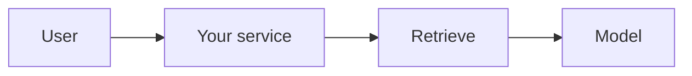

# Design Review · [product name] · [team name]

*Copy to `docs/DESIGN-REVIEW.md`. Four pages at most. Link to files instead of pasting them. Every claim points at evidence: a file, a log line, a test, a decision record. Brief and rubric: `Lab-4/DESIGN-REVIEW.md`. Filled example: `Lab-4/examples/DESIGN-REVIEW-campuspulse.md`. Delete these italic lines before you submit.*

Members: [name · GitHub username · role] · Repo: [link] · Graded commit: tag `design-review`

## 1 · Problem, users, success criteria (2 points)

*Who has the problem, how they solve it today, and why that is not good enough. Then 2 to 4 criteria a script or a log could check. Link `docs/spec.md`.*

**Problem.** ...

**Users.** ...

| # | Success criterion | Measured by | Today |
|---|---|---|---|
| S1 | | | |
| S2 | | | |

## 2 · Architecture and data flow (2 points)

*One diagram showing every model call, the Lab 4 retrieval path, your Lab 3 feature, your data stores, and where a human is in the loop. Mermaid renders on GitHub. Then one short paragraph for each arrow that is not obvious.*

| Model call | Model id | Input | Output | Validated by |
|---|---|---|---|---|
| | | | | |

## 3 · Risks and safety threats (2 points)

*At least four risks specific to your product. Each with a mitigation that exists (link it) or a dated plan, and an owner.*

| Risk | What a user would see | Mitigation (link, or plan and week) | Owner |
|---|---|---|---|
| | | | |

## 4 · Evaluation plan (2 points)

*Link `evals/golden.yaml` and the committed result. State the pass rate honestly, and what failed and why. Then what you add by Week 11 (10 questions: 3 factual, 2 reasoning, 2 edge, 2 refusal, 1 format) and what the 0.70 gate will block.*

- Golden set: [link] · last live run: [date, file link] · result: [x/5, pass rate]
- What failed and why: ...
- By Week 11: ...

## 5 · Token budget (1 point)

*Per-request cost and latency from your own `logs/usage.jsonl` (median over at least 10 real calls), then a monthly estimate at a stated load. Include the RAG-or-long-context arithmetic.*

| Feature | Model | Tokens in / out (median) | Cost per request | Latency (median) | Source |
|---|---|---|---|---|---|
| | | | | | |

Monthly at [users × requests per day]: ...

## 6 · Team, roles and decisions (1 point)

- Team contract: `TEAM-CONTRACT.md` on `main` · roles: `docs/TEAM-REPO.md` section 1
- Decision records: [link] · [link]
- What we build next, and who drives it: ...
